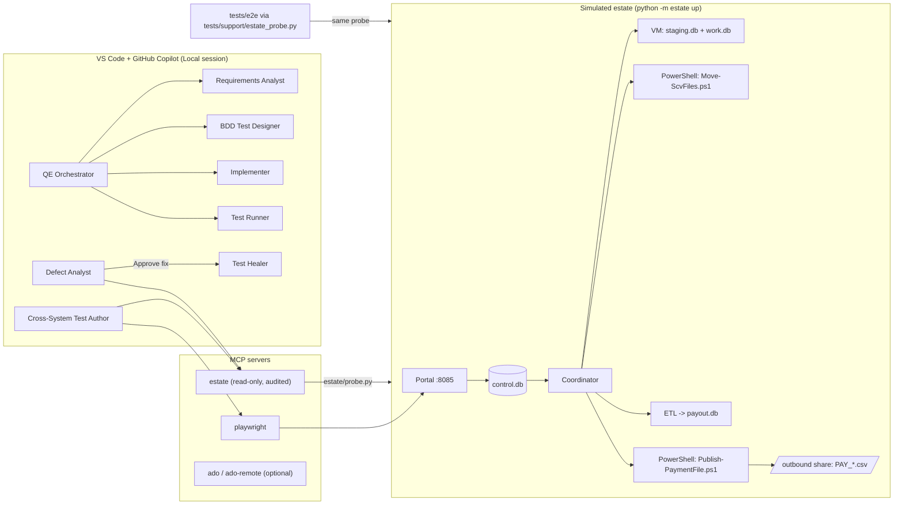

# Agentic QE demo kit - multi-agent orchestration for testing & quality engineering

Prepared for FSCS — Multi-Agent Orchestration Demo, 5 October 2026.

A runnable GitHub Copilot demo: a team of custom agents delivers a user story end to end (with a human
approval gate), tests a legacy-style estate **behind the UI** through a governed read-only MCP server,
analyses a patch-induced failure and heals it with a human in the loop.

> **Fictional data only.** "Contoso Building Society", case `CBS-2026-001` and "Synthetic Depositor 001..."
> are invented. Simplified rules for demonstration only — not FSCS policy. Nothing here connects to a real system.

## What it demonstrates

| Demo | Story | Agents |
|---|---|---|
| **1 - "Ticket 123"** | A QE Orchestrator delivers STORY-123: requirements gaps -> **human gate** -> BDD tests and code written by *separate* agents in parallel -> verification, coverage and a traceability report (optionally Azure DevOps test cases). | QE Orchestrator, Requirements Analyst, BDD Test Designer, Implementer, Test Runner |
| **2 - Behind the wall** | A payout run crosses portal -> coordinator -> simulated VM (two databases) -> PowerShell file moves -> ETL -> payment file. A simulated server patch silently breaks publishing: the UI-only test stays green, the cross-system test catches it. Root-cause analysis with an evidence chain, then an approved fix. | Cross-System Test Author, Defect Analyst, Test Healer |
| **3 - Scale and govern** | The same agents in the Copilot cloud agent; least-privilege tools, read-only MCP with an audit log, approval gates, AI credits per sub-agent. | all |
| **4 - Modernise (optional)** | Migrate a SpecFlow + Selenium C# test to pytest-bdd + Playwright and flag a stale business rule (£85,000 -> £120,000). | Framework Migrator |

Key messages: *AI carries the rules, humans keep the judgment* - *agents author and heal tests; pipelines run
deterministic tests* - *look behind the wall* - *start small, read-only first, least privilege*.

## Quick start

Prerequisites: Python 3.11+, Git, VS Code with GitHub Copilot, Node.js 20+ (for the Playwright MCP server).
PowerShell is optional (Windows PowerShell 5.1 or pwsh 7; the estate falls back to Python automatically).

**Windows (PowerShell)**
```powershell
cd agentic-qe-demo-kit
python scripts/setup.py
.venv\Scripts\Activate.ps1
python -m estate up            # keep this terminal open; portal on http://localhost:8085
```

**macOS / Linux**
```bash
cd agentic-qe-demo-kit
python3 scripts/setup.py
source .venv/bin/activate
python -m estate up            # keep this terminal open; portal on http://localhost:8085
```

Then in VS Code: open the folder, start the **estate** and **playwright** MCP servers (MCP servers view),
set the chat session target to **Local**, pick an agent (e.g. **QE Orchestrator**) and follow
[`docs/DEMO-RUNBOOK.md`](docs/DEMO-RUNBOOK.md). Before a live session use
[`docs/REHEARSAL-CHECKLIST.md`](docs/REHEARSAL-CHECKLIST.md).

## Commands

| Purpose | Command |
|---|---|
| One-time setup (creates `.venv`, installs deps, Playwright Chromium, writes `.vscode/mcp.json` with the venv interpreter for this OS, initialises the estate, smoke test) | `python scripts/setup.py` (optional: `--ado-org <org>` adds the **remote** ADO MCP server; `--ado-local <org>` adds the local npx server) |
| Activate venv | Windows: `.venv\Scripts\Activate.ps1` · macOS/Linux: `source .venv/bin/activate` |
| Start the estate (portal + coordinator, Ctrl+C to stop) | `python -m estate up` |
| Estate status / health | `python -m estate status` |
| Reset estate data (safe while running; keeps patch-drift state) | `python -m estate reset` |
| Simulate the server patch / undo it | `python -m estate patch-drift on` · `python -m estate patch-drift off` |
| Unit + BDD tests | `pytest tests/unit tests/bdd` |
| Story 123 scenarios only | `pytest tests/bdd -m story_123` |
| End-to-end (needs estate running) | `pytest tests/e2e -m e2e` (add `--headed` to show the browser) |
| Coverage for the rules engine | `pytest tests/unit tests/bdd --cov=payout --cov-report=term-missing` |
| Fallbacks (Plan B) | `python scripts/apply_fallback.py --list` · `python scripts/apply_fallback.py <name>` |
| Reset code + data to baseline between rehearsals | `python scripts/reset_demo.py` (restores git tag `demo-baseline`, then `estate reset`) |
| Pre-flight check (estate running) | `python scripts/preflight.py` |

Environment variables: `ESTATE_SPEED` (2 = twice as fast, 0.5 = slower; default 1, a run takes ~10-15 s),
`ESTATE_SHELL=auto|powershell|python` (default `auto`: pwsh, then Windows PowerShell, then the Python fallback).

## Architecture



```
Portal "Start payout run" -> control DB (QUEUED) -> Coordinator (polls every 2 s)
  -> PROVISIONING_VM -> STAGING_FILES (PowerShell) -> LOADING_SCV -> CALCULATING (ETL)
  -> PUBLISHING (PowerShell) -> ARCHIVING -> DEPROVISIONING_VM -> COMPLETED | FAILED (reason)
```

More detail: [`docs/ARCHITECTURE.md`](docs/ARCHITECTURE.md). Hands-on ideas: [`docs/EXERCISES.md`](docs/EXERCISES.md).

## Repository layout

| Path | What |
|---|---|
| `.github/agents/` | 9 custom agents (`*.agent.md`) |
| `.github/skills/` | Skills: `deposit-compensation-rules`, `cross-system-testing`, `bdd-pytest`, `playwright-python`, `legacy-test-migration` |
| `.github/instructions/`, `.github/copilot-instructions.md` | Repo-wide and path-scoped instructions |
| `.github/prompts/` | Demo prompts (`/deliver-story`, `/explore-payout-run`, `/analyse-failure`, `/migrate-legacy-test`) |
| `.github/workflows/` | `copilot-setup-steps.yml` (cloud agent toolchain), `qe-tests.yml` (deterministic tests on PRs) |
| `payout/` | Compensation rules engine |
| `estate/` | Simulated legacy estate (portal, coordinator, steps, PowerShell, probe) |
| `mcp_servers/estate/` | Governed read-only MCP server |
| `tests/` | `unit/`, `bdd/`, `e2e/`, `support/` |
| `work-items/` | STORY-123 |
| `legacy/specflow-selenium/` | Legacy C# sample for migration (not built) |
| `demo-fallbacks/` | Plan B outputs for every agent step (presenter only) |
| `scripts/` | `setup.py`, `apply_fallback.py`, `reset_demo.py`, `preflight.py` |
| `docs/` | Runbook, architecture, exercises, rehearsal checklist |

## Customise for your own estate

Replace `estate/` with a thin, **read-only** probe over one real (non-production) flow, expose it through a
small MCP server like `mcp_servers/estate/`, and keep the same pattern: agents explore and write tests; CI runs
the deterministic tests; humans approve at the gates.
