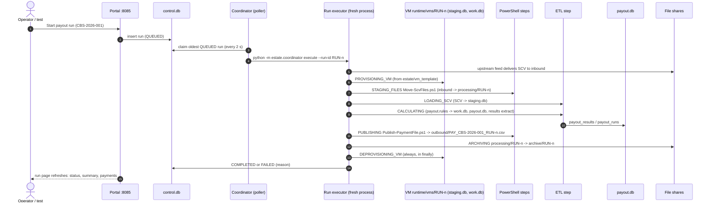
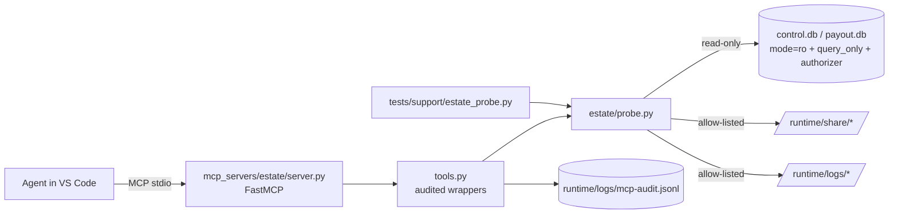
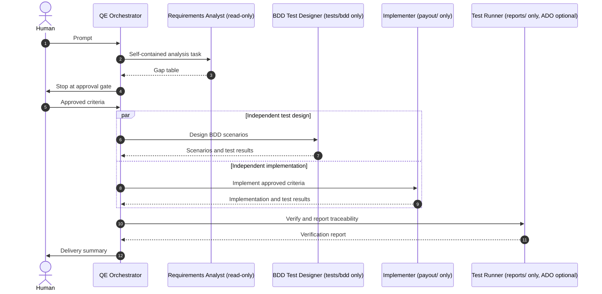

# Architecture

Simplified rules for demonstration only — not FSCS policy. All data is synthetic.

## 1. The simulated estate

The estate mirrors a common legacy pattern - a web portal, a job coordinator, a template VM with two
databases spun up per run, PowerShell file moves, an ETL step and file shares - without copying any real
system. It runs locally with `python -m estate up` (portal + coordinator in one process; every step in its
own process).



| Component | Code | Notes |
|---|---|---|
| Portal | `estate/portal.py` | stdlib HTTP server on loopback (127.0.0.1 and ::1). Pages `/`, `/runs/<id>`; API `/api/health`, `/api/runs`, `/api/runs/<id>`; `POST /api/admin/reset` (local admin token). Accessible markup with `data-testid`s. |
| Coordinator | `estate/coordinator.py` | `Coordinator` polls the control DB; each run executes in a **fresh process**, so code changes apply to the next run without a restart. Each step's command and exit code are recorded in `run_steps`. |
| Steps | `estate/steps/*.py`, `estate/powershell/*.ps1` | Separate processes. Exit codes: 0 ok, 1 missing share/file, 2 invalid data, 3 unexpected. |
| Shell choice | `estate/shell.py` | `ESTATE_SHELL=auto` tries `pwsh`, then Windows `powershell`, then Python - a PowerShell host is used only if it can actually run a script (execution policy). On Windows: `-NoProfile -ExecutionPolicy Bypass -File`. |
| Rules | `payout/rules.py` | `calculate_compensation`; limit from `payout/config.py`. |
| Probe | `estate/probe.py` | Read-only, guarded view used by the MCP server **and** the tests. |

### Runtime layout (gitignored)

```
runtime/
  share/inbound | processing/<run_id> | outbound | archive/<run_id>
  vms/<run_id>/            staging.db, work.db, vm.json (exists only during a run)
  db/control.db            runs, run_events, run_steps
  db/payout.db             payout_results (money as integer pence + 2 dp text), payout_runs
  logs/portal.log, coordinator.log, steps.log, etl.log, mcp-audit.jsonl
  config/estate.override.json   (written by python -m estate patch-drift on)
```

Effective configuration = `estate/config/estate.json` merged with `runtime/config/estate.override.json`.
The simulated server patch (`python -m estate patch-drift on`) writes
`{"outbound_share": "runtime/share/outbound-v2", "_note": "Applied by server patch KB-DEMO-0042 (simulated)"}`.

### Payment file

```
H,CBS-2026-001,<run_id>,<YYYY-MM-DD>
D,<depositor_id>,<amount 2dp>        one line per depositor with compensation > 0
T,<record_count>,<total 2dp>
```
UTF-8 without BOM, LF line endings, written as `<name>.partial` then renamed.

### Reset safety

`python -m estate reset` is a **logical** reset: it deletes rows and files but never the SQLite files or
open logs (Windows file locks). If the estate is running, the CLI asks it to reset through
`/api/admin/reset`, which waits for the coordinator's run lock - so a reset never collides with a run.
The patch-drift override and the MCP audit log are kept.

## 2. The governed MCP server `estate`



| Tool | Purpose |
|---|---|
| `estate_health` | Portal, coordinator heartbeat, databases, shares (effective paths), patch drift, runs by status, active VMs |
| `get_run(run_id)` | Run row, event timeline, every step's command, exit code and stderr tail, VM presence |
| `list_runs(limit)` | Recent runs |
| `list_share(area)` | Files in `inbound`, `processing`, `outbound` or `archive` (effective configuration) |
| `read_share_file(area, name, max_lines)` | Head of a text file in a share |
| `query_db(database, sql, max_rows)` | One SELECT/WITH on `control` or `payout` |
| `tail_log(component, lines)` | `portal`, `coordinator`, `steps`, `etl`, `mcp-audit` |
| `get_effective_config` | Baseline vs override vs effective, differences, share paths |

Guardrails (all enforced in `estate/probe.py`, tested in `tests/unit/test_mcp_guardrails.py`):
allow-listed roots only (shares must resolve inside `runtime/`); absolute paths, `..` and symlink escapes
blocked; SQL limited to a single `SELECT`/`WITH` (comments and literals understood), then executed on a
connection opened with `mode=ro`, `PRAGMA query_only=ON` and an authorizer that denies anything but reads;
caps on rows (500), lines (500), listings and file size; a 2-second query time limit; every call - allowed,
denied or failed - appended to `runtime/logs/mcp-audit.jsonl`. Tools are annotated read-only.

## 3. The agent team



| Agent | Tools (least privilege) | Hand-off button |
|---|---|---|
| QE Orchestrator | agent, read, search, edit, execute, todo, ado/*, ado-remote/* | - |
| Requirements Analyst | read, search, ado/*, ado-remote/* | Design BDD scenarios -> BDD Test Designer |
| BDD Test Designer | read, search, edit, execute | Implement to make the scenarios pass -> Implementer |
| Implementer | read, search, edit, execute | Verify and report traceability -> Test Runner |
| Test Runner | read, search, execute, edit (reports/), ado/*, ado-remote/* | - |
| Cross-System Test Author | read, search, edit, execute, playwright/*, estate/* | - |
| Defect Analyst | read, search, execute, estate/*, playwright/*, ado/*, ado-remote/* (no edit) | Approve fix → Test Healer |
| Test Healer | read, search, edit, execute, playwright/*, estate/* | - |
| Framework Migrator | read, search, edit, execute | - |

Sub-agents run in their own context (they do not inherit the conversation), which is why the orchestrator
writes self-contained tasks and persists the approved criteria to `reports/`. Azure DevOps tools are used
only if an ADO MCP server is configured (`ado` local or `ado-remote`); otherwise agents fall back to
`work-items/` and `reports/`. No agent pins a model.

## 4. Test layers

| Layer | Where | Runs in CI | Notes |
|---|---|---|---|
| Unit | `tests/unit` | yes | rules, money, SCV, payment file, config, MCP guardrails, PowerShell/Python parity |
| BDD | `tests/bdd` | yes | pytest-bdd; tags `@story_123`, `@ac_n`, `@gap_gn` give traceability |
| End-to-end | `tests/e2e` | yes (`qe-tests.yml` starts the estate) | Playwright + behind-the-UI checks via the probe |

Determinism: no sleeps (polling with timeouts), synthetic fixed data, the limit read from configuration,
one payout run per test.
